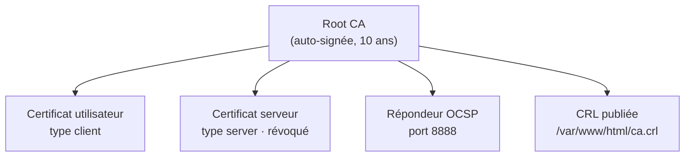

# Mise en place d'une PKI avec OpenSSL et Easy-RSA

🇬🇧 [English version](README.md) · 🇫🇷 **Français**

Déploiement d'une infrastructure à clés publiques (PKI) complète sur openSUSE : création d'une autorité de certification racine, émission de certificats utilisateur et serveur, révocation, publication de la CRL et répondeur OCSP. La CA a été construite de deux façons, **manuellement avec OpenSSL** puis **avec Easy-RSA**, afin de comparer les deux approches.

> Projet académique réalisé en groupe de trois étudiants · Bac 2 Cybersécurité · Institut Technique Supérieur Cardinal Mercier (Bruxelles) · année 2025-2026

---

## Objectifs

- Comprendre et appliquer les principes cryptographiques d'une PKI
- Mettre en place une autorité de certification racine et émettre des certificats finaux
- Émettre, gérer et révoquer des certificats X.509
- Distribuer la CRL via un serveur web (Apache) et vérifier les statuts avec OCSP
- Documenter chaque étape de façon professionnelle

## Environnement

| | |
|---|---|
| **OS** | openSUSE Leap 15.6 (VM VirtualBox) |
| **Outils** | OpenSSL, Easy-RSA |
| **Publication** | Apache HTTP Server |
| **Cryptographie** | RSA 4096 bits, SHA-256, clés protégées en AES-256 |

## Architecture



## Étapes réalisées

1. **Arborescence de la PKI** : séparation CA / utilisateurs, permissions restrictives sur les clés privées
2. **CA racine avec OpenSSL** : clé RSA 4096 chiffrée, certificat auto-signé, vérification des extensions (`CA:TRUE`)
3. **CA avec Easy-RSA** : installation, configuration isolée (`vars`), `init-pki`, `build-ca`
4. **Certificats finaux** : génération des CSR, signature en tant que `client` et `server`, export PKCS#12
5. **Révocation** : révocation du certificat serveur, vérification dans `index.txt`
6. **CRL et OCSP** : génération et publication de la CRL sur Apache, mise en place d'un répondeur OCSP

➡️ **Procédure complète, commandes expliquées et captures : [docs/fr/procedure.md](docs/fr/procedure.md)**


## OpenSSL ou Easy-RSA ?

| | OpenSSL (manuel) | Easy-RSA |
|---|---|---|
| **Arborescence** | Créée à la main (`mkdir`, `index.txt`, `serial`) | Une commande : `easyrsa init-pki` |
| **Création de la CA** | `genrsa` + `req -x509` + `chmod` | Une commande : `easyrsa build-ca` |
| **Contrôle** | Total, chaque paramètre est explicite | Paramètres par défaut via le fichier `vars` |
| **Intérêt** | Comprendre ce qui se passe réellement | Gagner du temps, limiter les erreurs |

La méthode manuelle permet de comprendre chaque brique ; Easy-RSA s'appuie sur OpenSSL et automatise les mêmes opérations.

## Difficultés rencontrées

- **Conflit PackageKit sur openSUSE** : l'installation d'Easy-RSA était bloquée. Solution : arrêter PackageKit avec `sudo pkcon quit` avant `zypper install`.
- **Certificat révoqué introuvable** : après révocation, Easy-RSA déplace le certificat dans `pki/revoked/certs_by_serial/` et le renomme par son numéro de série. Retrouvé avec `find`.
- **Cohérence OCSP** : le répondeur OCSP doit utiliser l'index et le certificat de la CA qui a réellement émis les certificats testés. Corrigé dans [`scripts/05-ocsp.sh`](scripts/05-ocsp.sh).

## Contenu du dépôt

```
├── README.md               Version anglaise
├── README.fr.md            Version française
├── docs/
│   ├── fr/                 Documentation en français
│   │   ├── concepts.md       Théorie : PKI, CA, RA, X.509, CP/CPS
│   │   ├── procedure.md      Mise en œuvre pas à pas, avec captures
│   │   └── solutions-pki.md  Panorama des solutions du marché
│   ├── en/                 Documentation en anglais
│   └── bibliography.md
├── scripts/                Commandes regroupées en scripts (commentaires en anglais)
├── configs/vars            Paramètres Easy-RSA
└── screenshots/
```

Les scripts et la configuration ont été **reconstitués à partir de la documentation du projet**, la machine virtuelle d'origine n'étant plus disponible.

## Sécurité

Projet réalisé dans un environnement de laboratoire. **Aucune clé privée, aucun fichier PKCS#12 ni aucun mot de passe n'est publié** dans ce dépôt (voir [`.gitignore`](.gitignore)).

## Pour aller plus loin

- Ajouter une **CA intermédiaire** et garder la Root CA hors ligne
- Émettre le certificat du répondeur OCSP avec l'usage étendu **OCSP Signing**
- Configurer un **VirtualHost HTTPS** Apache avec le certificat serveur
- Ajouter les points de distribution CRL et l'URL OCSP (extensions **CDP** et **AIA**) dans les certificats émis
