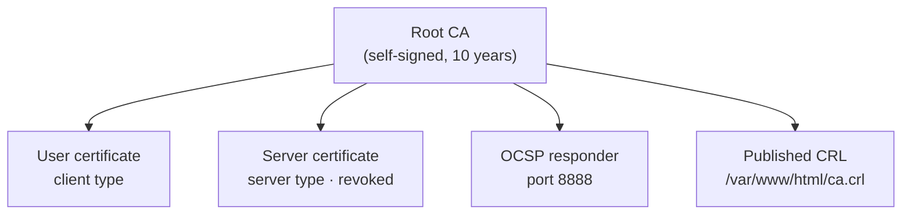
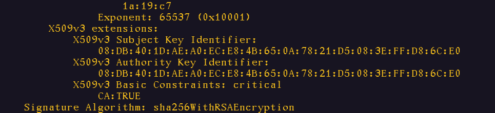
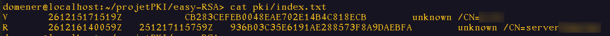

# Building a PKI with OpenSSL and Easy-RSA

🇬🇧 **English** · 🇫🇷 [Version française](README.fr.md)

Deployment of a complete Public Key Infrastructure (PKI) on openSUSE: creation of a root certificate authority, issuance of user and server certificates, revocation, CRL publication and an OCSP responder. The CA was built in two ways, **manually with OpenSSL** and then **with Easy-RSA**, in order to compare both approaches.

> Academic group project (three students) · 2nd-year Bachelor in Cybersecurity · Institut Technique Supérieur Cardinal Mercier (Brussels) · 2025-2026

---

## Objectives

- Understand and apply the cryptographic principles behind a PKI
- Set up a root certificate authority and issue end-entity certificates
- Issue, manage and revoke X.509 certificates
- Distribute the CRL through a web server (Apache) and check certificate status with OCSP
- Document every step in a professional way

## Environment

| | |
|---|---|
| **OS** | openSUSE Leap 15.6 (VirtualBox VM) |
| **Tools** | OpenSSL, Easy-RSA |
| **Publication** | Apache HTTP Server |
| **Cryptography** | RSA 4096-bit, SHA-256, AES-256-encrypted private keys |

## Architecture



## Steps completed

1. **PKI directory structure**: separation between CA and users, restrictive permissions on private keys
2. **Root CA with OpenSSL**: encrypted RSA 4096 key, self-signed certificate, extension check (`CA:TRUE`)
3. **CA with Easy-RSA**: installation, isolated configuration (`vars`), `init-pki`, `build-ca`
4. **End-entity certificates**: CSR generation, signing as `client` and `server`, PKCS#12 export
5. **Revocation**: revoking the server certificate, checking `index.txt`
6. **CRL and OCSP**: generating and publishing the CRL on Apache, setting up an OCSP responder

➡️ **Full procedure, explained commands and screenshots: [docs/en/procedure.md](docs/en/procedure.md)**





## OpenSSL or Easy-RSA?

| | OpenSSL (manual) | Easy-RSA |
|---|---|---|
| **Directory structure** | Built by hand (`mkdir`, `index.txt`, `serial`) | One command: `easyrsa init-pki` |
| **CA creation** | `genrsa` + `req -x509` + `chmod` | One command: `easyrsa build-ca` |
| **Control** | Full, every parameter is explicit | Defaults set in the `vars` file |
| **Benefit** | Understanding what really happens | Saving time, reducing mistakes |

The manual method shows how each building block works; Easy-RSA relies on OpenSSL and automates the same operations.

## Challenges

- **PackageKit conflict on openSUSE**: Easy-RSA installation was blocked. Fix: stop PackageKit with `sudo pkcon quit` before running `zypper install`.
- **Revoked certificate not found**: after revocation, Easy-RSA moves the certificate to `pki/revoked/certs_by_serial/` and renames it after its serial number. Located with `find`.
- **OCSP consistency**: the OCSP responder must use the index and certificate of the CA that actually issued the tested certificates. Fixed in [`scripts/05-ocsp.sh`](scripts/05-ocsp.sh).

## Repository content

```
├── README.md               English version
├── README.fr.md            French version
├── docs/
│   ├── en/                 English documentation
│   │   ├── concepts.md       Theory: PKI, CA, RA, X.509, CP/CPS
│   │   ├── procedure.md      Step-by-step implementation, with screenshots
│   │   └── pki-solutions.md  Overview of market solutions
│   ├── fr/                 French documentation
│   └── bibliography.md
├── scripts/                Commands grouped into commented scripts
├── configs/vars            Easy-RSA parameters
└── screenshots/
```

The scripts and configuration were **rebuilt from the project documentation**, as the original virtual machine is no longer available. Screenshots come from the original lab, so their terminal output is in English and file names are in French.

## Security

This project was carried out in a lab environment. **No private key, PKCS#12 file or password is published** in this repository (see [`.gitignore`](.gitignore)). Certificate names and personal information have been anonymised.

## Next steps

- Add an **intermediate CA** and keep the root CA offline
- Issue the OCSP responder certificate with the **OCSP Signing** extended key usage
- Configure an Apache **HTTPS VirtualHost** with the server certificate
- Add CRL distribution points and the OCSP URL (**CDP** and **AIA** extensions) to issued certificates
