# Procédure technique : mise en œuvre de la PKI

[← Retour au README](../../README.fr.md) · [← Concepts théoriques](concepts.md)

> Les noms des certificats ont été anonymisés (`user1`, `server1`) et floutés sur les captures, de même que les informations personnelles.

## Sommaire

1. [Environnement](#1-environnement)
2. [Préparation de l'arborescence](#2-préparation-de-larborescence)
3. [Méthode 1 : CA racine avec OpenSSL](#3-méthode-1--ca-racine-avec-openssl)
4. [Méthode 2 : CA avec Easy-RSA](#4-méthode-2--ca-avec-easy-rsa)
5. [Certificats utilisateur et serveur](#5-certificats-utilisateur-et-serveur)
6. [Gestion des certificats et PKCS#12](#6-gestion-des-certificats-et-pkcs12)
7. [Révocation des certificats](#7-révocation-des-certificats)
8. [CRL et OCSP](#8-crl-et-ocsp)
9. [Problème rencontré : le certificat révoqué introuvable](#9-problème-rencontré--le-certificat-révoqué-introuvable)

---

## 1. Environnement

| Élément | Choix |
|---|---|
| Système | openSUSE Leap 15.6 (VM Oracle VirtualBox) |
| Outils | OpenSSL (gestion directe des clés et certificats), Easy-RSA (automatisation) |
| Distribution | Apache HTTP Server |
| Topologie | Root CA + certificats utilisateurs et serveurs |

---

## 2. Préparation de l'arborescence

Avant de créer l'autorité de certification, on prépare un répertoire dédié qui contiendra les clés privées, les certificats, les demandes de certificats (CSR) et les listes de révocation. L'objectif est de séparer clairement ce qui appartient à la CA de ce qui appartient aux utilisateurs.

```bash
mkdir -p ~/projetPKI/ca
mkdir ~/projetPKI/ca/private
mkdir ~/projetPKI/ca/certs
mkdir ~/projetPKI/ca/new
mkdir ~/projetPKI/ca/crl
mkdir ~/projetPKI/ca/csr
mkdir ~/projetPKI/users
mkdir ~/projetPKI/users/private
mkdir ~/projetPKI/users/csr
mkdir ~/projetPKI/users/certs
chmod 700 ~/projetPKI/ca/private
touch ~/projetPKI/ca/index.txt
echo 3000 > ~/projetPKI/ca/serial
```

- `mkdir -p` crée chaque dossier, ainsi que le chemin parent si nécessaire.
- `chmod 700` donne lecture, écriture et exécution au propriétaire uniquement (7), aucun droit au groupe (0) ni aux autres (0).
- `touch index.txt` crée un fichier vide qui servira de base de données des certificats émis.
- `echo 3000 > serial` initialise le compteur des numéros de série : chaque nouveau certificat incrémente cette valeur à partir de 3000.

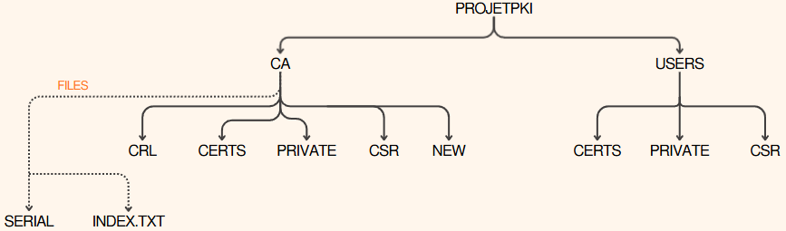

---

## 3. Méthode 1 : CA racine avec OpenSSL

On crée la CA racine directement avec OpenSSL. Elle constitue le sommet de la hiérarchie de confiance et signe tous les autres certificats.

### Générer la clé privée de la CA

```bash
cd ~/projetPKI/ca
openssl genrsa -aes256 -out private/ca.key 4096
```

| Paramètre | Rôle |
|---|---|
| `openssl genrsa` | Génère une clé RSA |
| `-aes256` | Chiffre la clé en AES-256 (protection par mot de passe) |
| `-out private/ca.key` | Emplacement de la clé |
| `4096` | Taille de la clé en bits |

La clé privée de la CA est l'élément le plus sensible de la PKI, puisqu'elle signe tous les certificats. Elle est donc protégée par un mot de passe.

### Sécuriser les permissions

```bash
chmod 600 private/ca.key
```

`600` : seul le propriétaire peut lire et écrire le fichier.

### Créer le certificat auto-signé de la CA racine

```bash
openssl req -x509 -new -key private/ca.key -sha256 -days 3650 -out certs/ca.crt
```

| Paramètre | Rôle |
|---|---|
| `openssl req` | Crée une requête de certificat ou un certificat X.509 |
| `-x509` | Produit directement un certificat auto-signé (et non une CSR) |
| `-new` | Nouvelle requête |
| `-key private/ca.key` | Utilise la clé privée créée juste avant |
| `-sha256` | Algorithme de hachage SHA-256 |
| `-days 3650` | Validité de 10 ans |
| `-out certs/ca.crt` | Fichier du certificat |

**Informations saisies :** Country `BE`, State `Belgium`, Locality `Bruxelles`, Organization `PKI-ITSCM`, Common Name et adresse e-mail de l'administrateur.

Ce certificat contient le nom, la période de validité et la clé publique. Il est auto-signé : c'est une racine, personne au-dessus ne le signe.

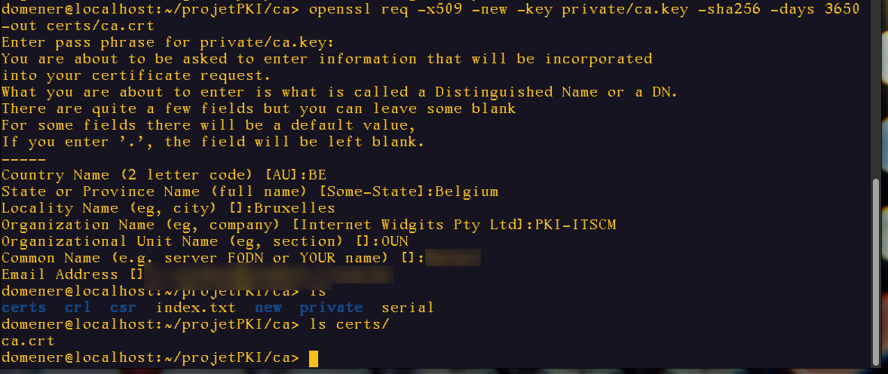

### Vérifier le certificat racine

```bash
openssl x509 -in certs/ca.crt -noout -text
```

| Paramètre | Rôle |
|---|---|
| `openssl x509` | Outil de gestion des certificats X.509 |
| `-in certs/ca.crt` | Certificat à examiner |
| `-noout` | N'affiche pas le certificat encodé en Base64 |
| `-text` | Affiche toutes les informations en clair |

Points à vérifier :

- le champ **Issuer** est identique au champ **Subject** (certificat auto-signé) ;
- l'extension **CA:TRUE** est présente ;
- la validité est bien de 10 ans.

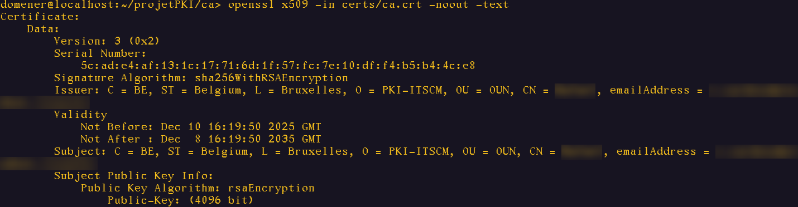


---

## 4. Méthode 2 : CA avec Easy-RSA

Easy-RSA est un ensemble de scripts qui simplifie la gestion d'une PKI : là où OpenSSL demande plusieurs commandes détaillées, Easy-RSA automatise les étapes.

### Installation sur openSUSE

```bash
sudo zypper install easy-rsa
```

> **Conflit rencontré :** PackageKit bloquait l'installation. Il faut d'abord l'arrêter avec `sudo pkcon quit`, puis relancer l'installation.

Vérification :

```bash
rpm -ql easy-rsa
```

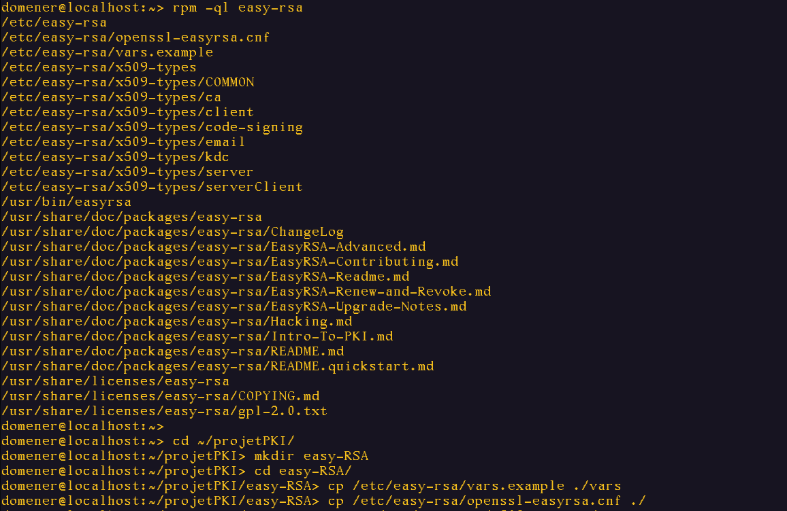

### Préparation de l'environnement

```bash
cd ~/projetPKI
mkdir easy-RSA
cd easy-RSA
cp /etc/easy-rsa/vars.example ./vars
cp /etc/easy-rsa/openssl-easyrsa.cnf ./
cp -r /etc/easy-rsa/x509-types ./
```

On utilise une configuration isolée, propre au projet, pour ne pas modifier la configuration système.

### Initialiser la PKI

```bash
easyrsa init-pki
```

Cette commande crée automatiquement `pki/private/`, `pki/reqs/`, `pki/issued/`, `pki/crl/`, ainsi que `index.txt` et `serial`. Elle remplace toutes les commandes de [l'étape 2](#2-préparation-de-larborescence).

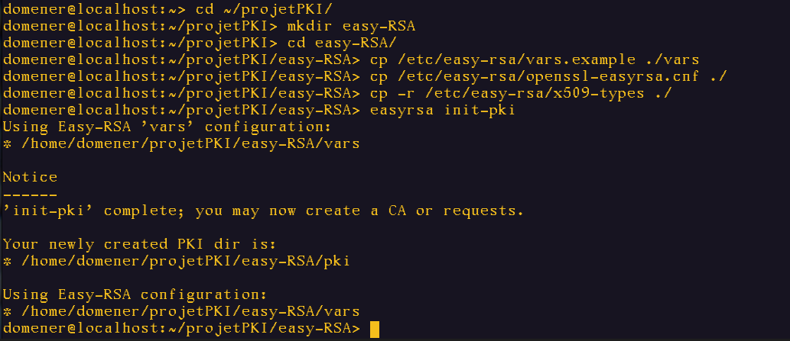

### Configurer le fichier `vars`

Le fichier `vars` définit les paramètres par défaut de la PKI, pour éviter de les ressaisir à chaque certificat.

```bash
nano vars
```

```bash
set_var EASYRSA_REQ_COUNTRY  "BE"
set_var EASYRSA_REQ_PROVINCE "Bruxelles"
set_var EASYRSA_REQ_CITY     "Bruxelles"
set_var EASYRSA_REQ_EMAIL    "<adresse-email>"
set_var EASYRSA_REQ_OU       "PKI-ITSCM"
set_var EASYRSA_KEY_SIZE     4096
set_var EASYRSA_CA_EXPIRE    3650
```

Le fichier complet est disponible dans [`configs/vars`](../../configs/vars).

### Créer la CA

```bash
easyrsa build-ca
```

Cette seule commande génère la clé privée (protégée par mot de passe), un certificat auto-signé valable 10 ans, applique les bonnes permissions et met à jour `index.txt` et `serial`.

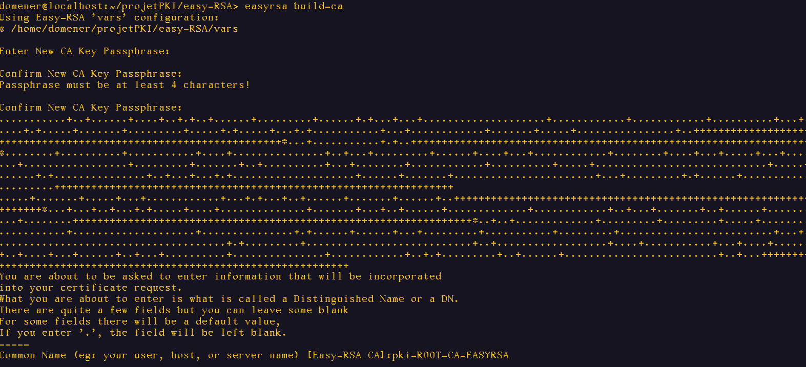

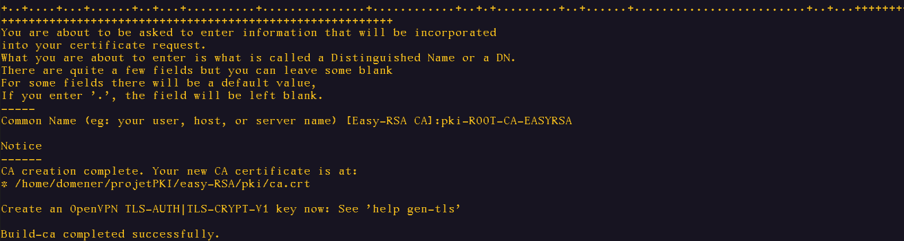

---

## 5. Certificats utilisateur et serveur

On crée maintenant des certificats signés par la CA. Les certificats **utilisateur** servent à l'authentification, à la signature d'e-mails ou au chiffrement de données. Les certificats **serveur** sécurisent les communications HTTPS ou VPN. On utilise Easy-RSA pour aller plus vite.

### Certificat utilisateur

**Générer la clé et la CSR :**

```bash
cd ~/projetPKI/easy-RSA
easyrsa gen-req user1
```

`gen-req` génère la clé privée et la demande de certificat (CSR) ; `user1` est le nom de l'utilisateur.

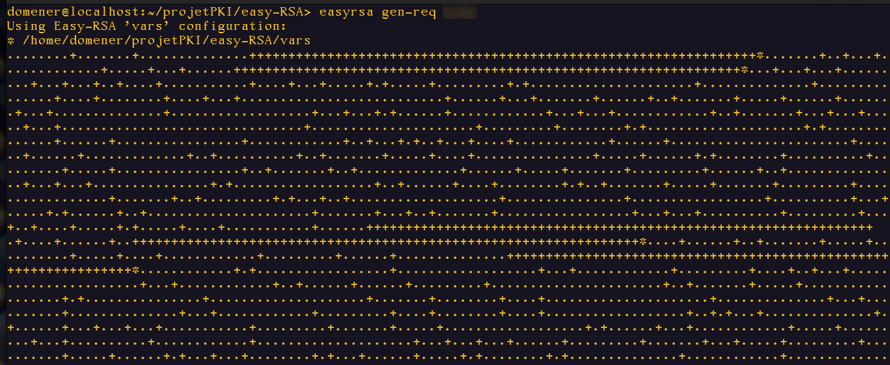

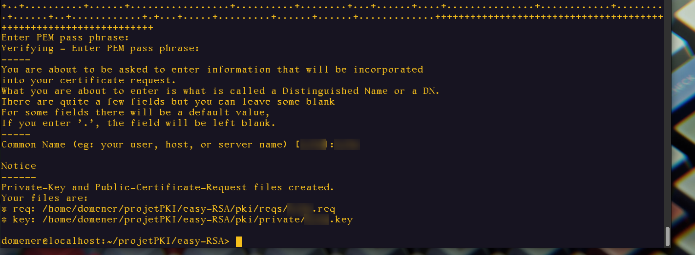

**Signer le certificat client :**

```bash
easyrsa sign-req client user1
```

`sign-req` signe une CSR ; `client` est le type de certificat (utilisateur).

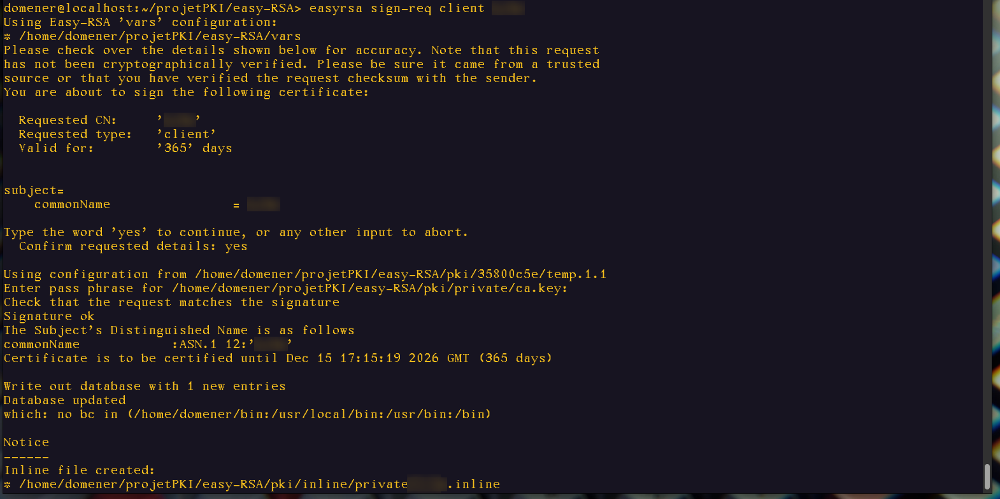

**Vérifier la base de données :**

```bash
cat pki/index.txt
```

Le certificat est bien enregistré : le **V** en début de ligne signifie *valide*.


### Certificat serveur

**Générer la clé et la CSR :**

```bash
easyrsa gen-req server1
```

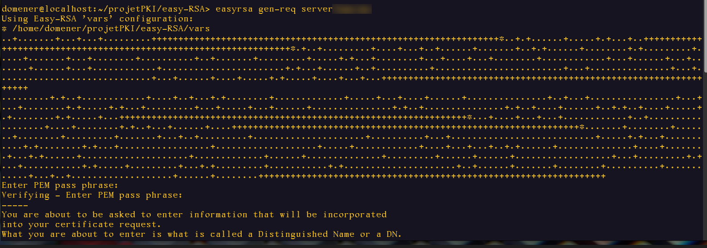

**Signer comme certificat serveur :**

```bash
easyrsa sign-req server server1
```

Le type `server` ajoute l'usage étendu *TLS Web Server Authentication*.

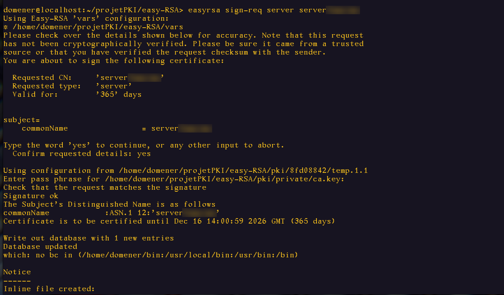

---

## 6. Gestion des certificats et PKCS#12

### Afficher les informations d'un certificat

```bash
openssl x509 -in ~/projetPKI/easy-RSA/pki/issued/user1.crt -noout -text
openssl x509 -in ~/projetPKI/easy-RSA/pki/issued/user1.crt -noout -dates
openssl x509 -in ~/projetPKI/easy-RSA/pki/issued/server1.crt -noout -subject
```

- `-text` affiche toutes les informations du certificat ;
- `-dates` affiche le début (`notBefore`) et la fin (`notAfter`) de validité ;
- `-subject` affiche le sujet, dont le Common Name (CN).

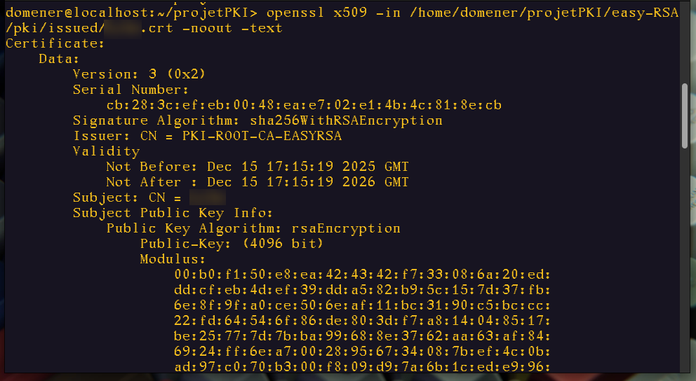

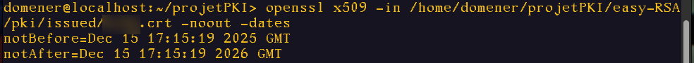

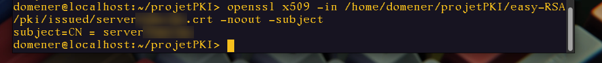

### Créer un fichier PKCS#12

Un fichier PKCS#12 (`.p12`) regroupe la clé privée de l'utilisateur, son certificat et le certificat de la CA, le tout protégé par mot de passe. C'est le format pratique pour remettre un certificat à un utilisateur.

```bash
cd ~/projetPKI/easy-RSA
openssl pkcs12 -export \
  -out pki/issued/user1.p12 \
  -inkey pki/private/user1.key \
  -in pki/issued/user1.crt \
  -certfile pki/ca.crt \
  -name "Certificat user1 - PKI ITSCM"
```

| Paramètre | Rôle |
|---|---|
| `pkcs12 -export` | Crée un fichier PKCS#12 |
| `-out` | Fichier de sortie |
| `-inkey` | Clé privée de l'utilisateur |
| `-in` | Certificat signé de l'utilisateur |
| `-certfile` | Certificat de la CA |
| `-name` | Nom d'affichage |

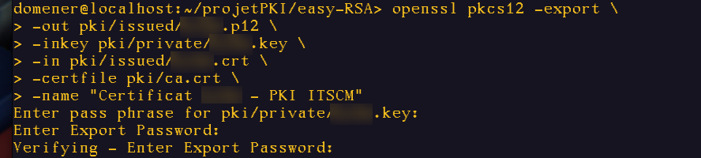

### Afficher le contenu du fichier PKCS#12

```bash
openssl pkcs12 -in pki/issued/user1.p12 -info -noout
```

`-info` affiche les informations sur la structure du fichier ; `-noout` masque le contenu encodé.

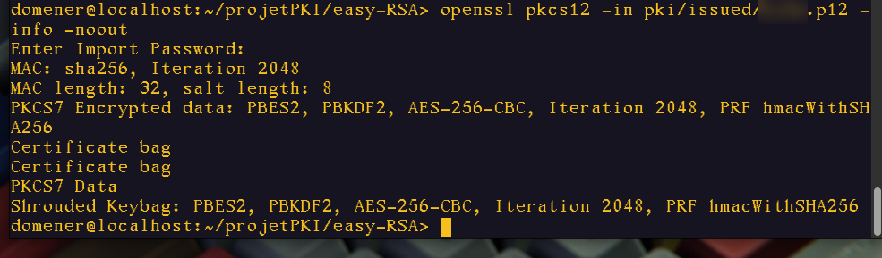

---

## 7. Révocation des certificats

Révoquer un certificat, c'est l'annuler avant sa date d'expiration. Les raisons courantes : clé privée compromise, départ d'un employé, erreur dans le certificat, changement de politique de sécurité.

```bash
easyrsa revoke server1
```

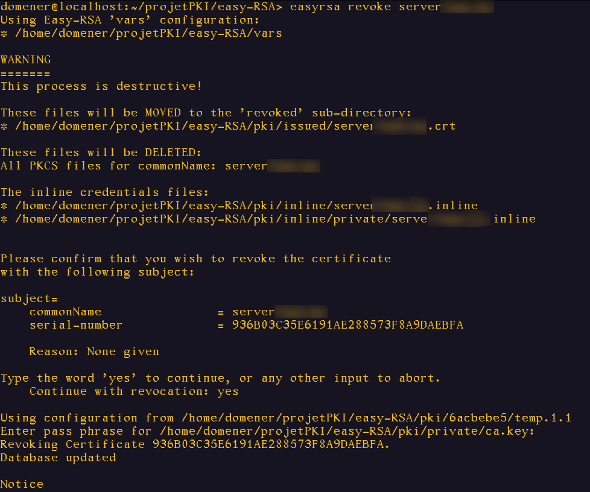

**Vérification dans l'index :**

```bash
cat pki/index.txt
```

Le **R** en début de deuxième ligne confirme que le certificat serveur est révoqué.


---

## 8. CRL et OCSP

Après chaque révocation, il faut régénérer la CRL pour qu'elle soit à jour. Une bonne pratique est de la régénérer régulièrement, même sans révocation, car une CRL a elle-même une date d'expiration.

### Générer la CRL

```bash
easyrsa gen-crl
```

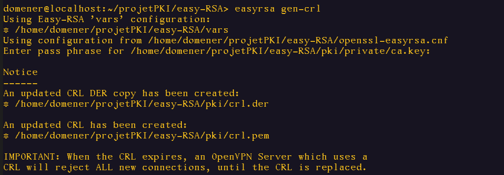

### Publier la CRL sur le serveur web

```bash
sudo mkdir -p /var/www/html
sudo cp pki/crl.pem /var/www/html/ca.crl
ls -lh /var/www/html/ca.crl
sudo chmod 644 /var/www/html/ca.crl
```

- On prépare le répertoire de publication web, puis on y copie la CRL.
- `ls -lh` confirme la copie.
- `chmod 644` rend le fichier lisible par tous, modifiable uniquement par root.

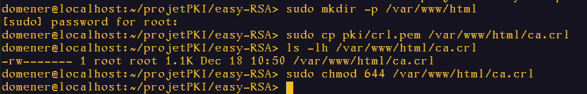

### Créer un certificat pour le répondeur OCSP

Les réponses OCSP doivent être signées pour ne pas pouvoir être falsifiées. En signant le certificat du répondeur avec notre CA, on garantit aux clients qu'ils peuvent lui faire confiance.

```bash
easyrsa gen-req ocsp-responder nopass
easyrsa sign-req server ocsp-responder
```

L'option `nopass` crée la clé privée sans mot de passe, pour que le serveur OCSP puisse démarrer sans intervention.

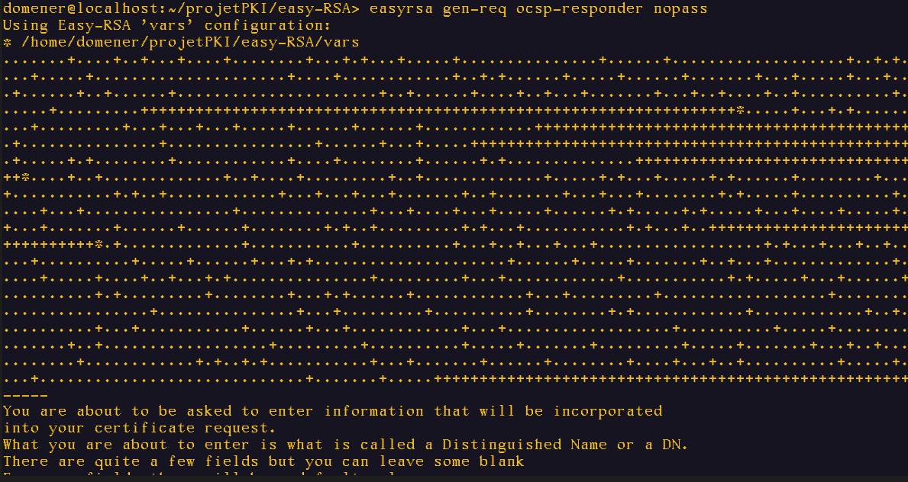

### Lancer le serveur OCSP

```bash
openssl ocsp \
  -index ~/projetPKI/ca/index.txt \
  -port 8888 \
  -rsigner ~/projetPKI/easy-RSA/pki/issued/ocsp-responder.crt \
  -rkey ~/projetPKI/easy-RSA/pki/private/ocsp-responder.key \
  -CA ~/projetPKI/ca/certs/ca.crt \
  -text
```

| Paramètre | Rôle |
|---|---|
| `openssl ocsp` | Lance OpenSSL en mode serveur OCSP |
| `-index` | Base de données contenant le statut des certificats |
| `-port 8888` | Port d'écoute |
| `-rsigner` | Certificat qui signe les réponses OCSP |
| `-rkey` | Clé privée associée |
| `-CA` | Certificat de la CA |
| `-text` | Affiche les réponses en détail |

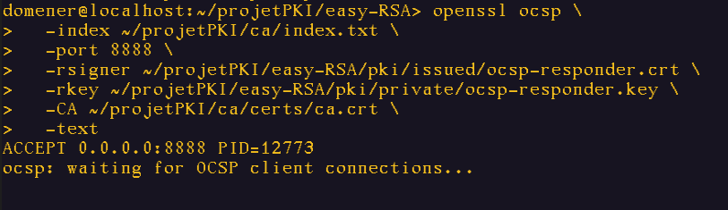

> **Remarque après relecture :** cette commande pointe vers l'index et le certificat de la CA OpenSSL (méthode 1), alors que les certificats testés ont été émis par la CA Easy-RSA (méthode 2). Pour interroger correctement le statut des certificats Easy-RSA, il faut utiliser `-index ~/projetPKI/easy-RSA/pki/index.txt` et `-CA ~/projetPKI/easy-RSA/pki/ca.crt`. La version corrigée se trouve dans [`scripts/05-ocsp.sh`](../../scripts/05-ocsp.sh).

### Interroger le serveur OCSP

Dans un second terminal :

```bash
openssl ocsp \
  -CAfile ~/projetPKI/easy-RSA/pki/ca.crt \
  -issuer ~/projetPKI/easy-RSA/pki/ca.crt \
  -cert ~/projetPKI/easy-RSA/pki/issued/user1.crt \
  -url http://localhost:8888/ \
  -resp_text
```

| Paramètre | Rôle |
|---|---|
| `-CAfile` | CA utilisée pour vérifier la signature de la réponse |
| `-issuer` | Certificat de l'autorité qui a émis le certificat testé |
| `-cert` | Certificat dont on veut connaître le statut |
| `-url` | Adresse du serveur OCSP |
| `-resp_text` | Affiche la réponse OCSP |

---

## 9. Problème rencontré : le certificat révoqué introuvable

En voulant vérifier via OCSP le statut du certificat révoqué, le fichier `server1.crt` n'existait plus dans `pki/issued/`.

**Explication :** lors d'une révocation, Easy-RSA déplace le certificat dans `pki/revoked/certs_by_serial/` et le renomme avec son **numéro de série** au lieu de son Common Name.

```bash
find ~/projetPKI/easy-RSA/pki/ -name "*.crt"
```

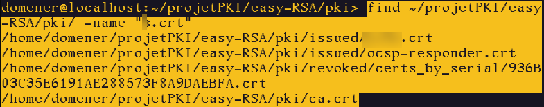

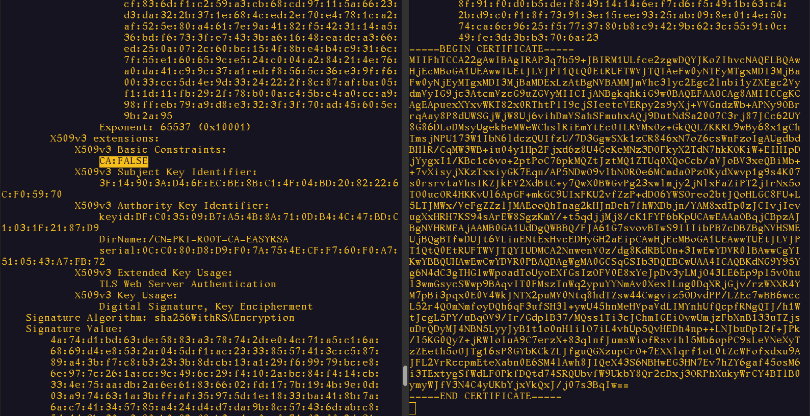
